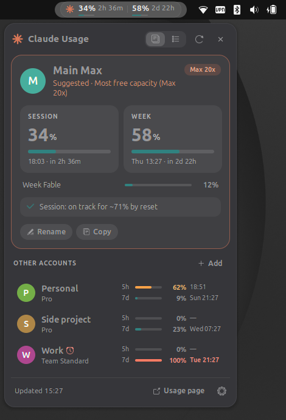
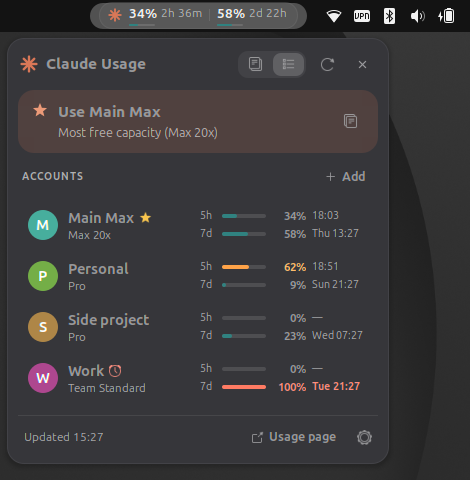
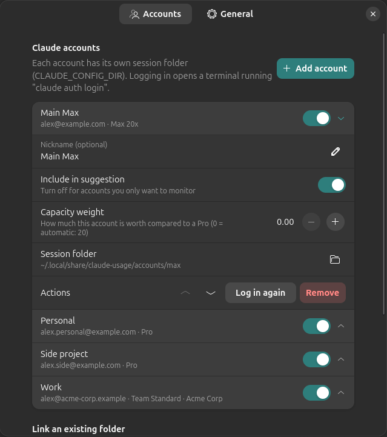
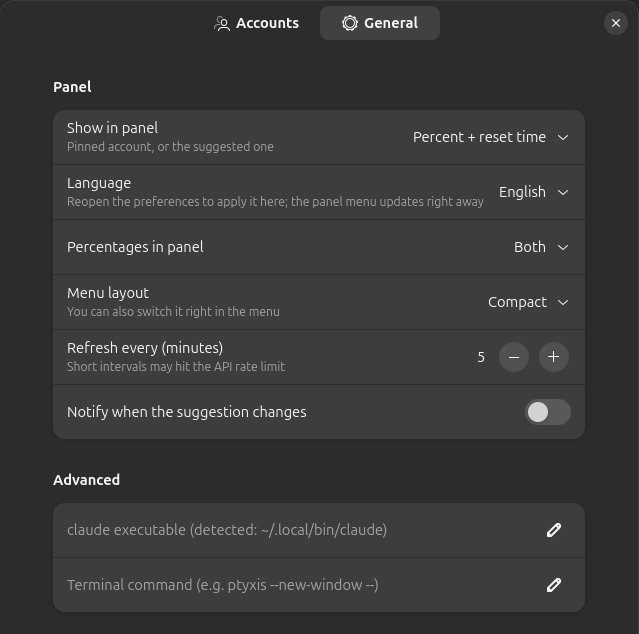

# Claude Juggler — GNOME Shell extension

Juggle several Claude accounts (Pro, Max, Team…) from the GNOME top bar: see the
session (5h) and weekly usage of each one, and get a suggestion of which account to use
right now.

| Detailed menu | Compact menu |
|---|---|
|  |  |

| Settings — Accounts | Settings — General |
|---|---|
|  |  |

*Screenshots use made-up accounts.*

- **Panel**: a pill `( ✱ 62% │ 33% )` with the session and/or weekly usage and the time
  until each reset, for the suggested account or the one you pinned by clicking it in the
  menu ("Unpin" goes back to following the suggestion). You can show 5h, 7d or both, with
  or without the account name, or just the icon. Hover the pill to see which account
  it shows.
- **Detailed menu**: a card for the current account with SESSION and WEEK tiles, per-model
  weekly limits such as Fable (on accounts that have them), a one-line insight ("at this
  pace, hits the limit in ~1h 20m", "frees up Wed 21/10 10:00") and the other accounts
  below. Click an account to pin it and see its details.
- **Compact menu**: the suggestion in a banner plus every account with mini bars and
  their reset times. Blocked accounts show an alarm icon (hover it to see which limit
  was hit) and the time they free up.
- Rename accounts right in the menu (or set a nickname in the preferences).
- Disable accounts without removing them: they keep their login and settings but are
  neither fetched nor shown.
- Optional notification when the suggestion changes.
- The ✕ in the menu header quits: it turns the extension off, stopping all polling.
  Turn it back on from the Extensions app or with
  `gnome-extensions enable claude-juggler@mbombonato.github.io`.
- Light and dark themes, using the system accent color.
- English (default), Portuguese (Brazil) and Spanish.

## Installation

```sh
./install.sh   # symlinks this folder into ~/.local/share/gnome-shell/extensions and enables it
# then log out and back in (on Wayland, GNOME Shell only loads new extensions at login)
```

Or run `make pack` to build a `.zip` in `dist/` (for `gnome-extensions install` or
uploading to extensions.gnome.org), and `make lint` to check it with EGO's static
analyzer, [Shexli](https://pypi.org/project/shexli/) (needs [uv](https://docs.astral.sh/uv/)).

## Accounts

Each account has its own session folder at
`~/.local/share/claude-juggler/accounts/<id>/`, used as `CLAUDE_CONFIG_DIR`.

- **Add account** opens a terminal running `claude auth login` against the new folder.
  When the login finishes, the extension picks up `.credentials.json` by itself.
  Tip: use a private browser window, or log out of claude.ai between logins, so you can
  choose the right account each time.
- **Link an existing folder** (preferences) tracks a folder that is already logged in,
  such as the default `~/.claude`, in **read-only** mode: the extension never renews its
  token; the Claude Code instance using that folder does.
- For the accounts it manages, the extension renews the access token and writes it back
  to the same file. Claude Code re-reads that file when it changes, so you can use the
  same folder from a terminal at the same time.
- The switch next to each account in the preferences disables it without removing it.

### Using an account in the terminal

"Copy" in the menu copies something like:

```sh
CLAUDE_CONFIG_DIR=~/.local/share/claude-juggler/accounts/<id> claude
```

Tip: create aliases (`alias claude-max='CLAUDE_CONFIG_DIR=… claude'`).

## How the suggestion works

Weekly quota that isn't used before the reset is lost. For each account:

```
score = plan_weight × (% of the week left) / hours until the weekly reset
        × a penalty when the 5h session is above 70%
```

Weights are relative to Pro: Pro 1, Team Standard 1.25, Max 5x 5, Team Premium 6.25 and
Max 20x 20. You can override the weight per account in the preferences.

Accounts with the session ≥ 97% or the week ≥ 99% are left out. In practice the Max 20x
wins most of the time, but a Pro with plenty of quota left that resets within a few
hours takes the lead. When every account is at its limit, the suggestion is the next one
to free up.

## API rate limits

The extension uses the same OAuth endpoints as Claude Code (`/api/oauth/usage` and
`/api/oauth/profile`). They are not a documented public API and may change. The usage
endpoint has a small per-token budget (shared with Claude Code's own `/usage`), so the
extension:

- refreshes every 5 minutes by default (configurable), waiting 10 seconds between
  accounts within a round;
- never sends two requests for the same account less than 2 minutes apart — not even
  when you press refresh;
- on HTTP 429, honors `Retry-After`, or otherwise waits 5 → 10 → 20 → 30 minutes on
  consecutive 429s, and never bypasses that wait;
- shows when the API frees up in the menu footer;
- keeps usage and rate-limit state in `~/.cache/claude-juggler/state.json`, so logging in,
  unlocking the screen or reloading shows the last data right away and only fetches
  accounts whose data is older than the refresh interval (opening the menu reuses data
  younger than 5 minutes).

To see every request and why it happened:

```sh
gsettings set org.gnome.shell.extensions.claude-juggler debug true
journalctl --user -f | grep claude-juggler
```

## Development: reloading without logging out

GNOME Shell doesn't reload the code of an extension that is already loaded: GJS caches
modules by file path. `dev-reload.sh` copies the extension to a new folder under
`~/.cache/claude-juggler-dev/` and loads it from there.

1. Once per session, turn on unsafe mode, which enables the Shell's D-Bus `Eval` method:
   `Alt+F2` → `lg` → **Evaluator** tab → `global.context.unsafe_mode = true`.
2. After each change: `make reload`.
3. When done, turn unsafe mode off (button in the notification the Shell shows, or
   `global.context.unsafe_mode = false` in `lg`). While it is on, any program in the
   session can run code inside the Shell.

Thanks to the state cache, a reload only fetches accounts whose data is older than the
refresh interval.

## Styling

- GNOME Shell loads `stylesheet-light.css` or `stylesheet-dark.css` for the current theme
  and reloads it when the theme changes. Both import `base.css`, which holds the layout;
  the theme files only define colors.
- Bars use the system accent color (`-st-accent-color`). The panel pill uses neutral
  translucent greys so it works on light (Yaru) and dark panels.

## Translations

English (default), Portuguese (Brazil) and Spanish. By default the extension follows the
system language. Settings → General → **Language** forces a language for the extension
only — useful when the system is in English and only the regional formats use another
language. Weekday and month names follow the system date format (`LC_TIME`).

To translate without the `gettext` package installed:

```sh
make pot            # updates po/claude-juggler.pot and the .po files (lists what's missing)
# edit po/<language>.po
make translations   # compiles to locale/<language>/LC_MESSAGES/claude-juggler.mo
```

For a new language, copy `po/claude-juggler.pot` to `po/<code>.po` and add the code to
`LANGUAGES` in `lib/i18n.js`.

## Notes

- Tested on GNOME Shell 50 (Wayland).

## License

Claude Juggler is an independent project, not affiliated with or endorsed by Anthropic.

[GPL-2.0-or-later](LICENSE), like GNOME Shell itself.
